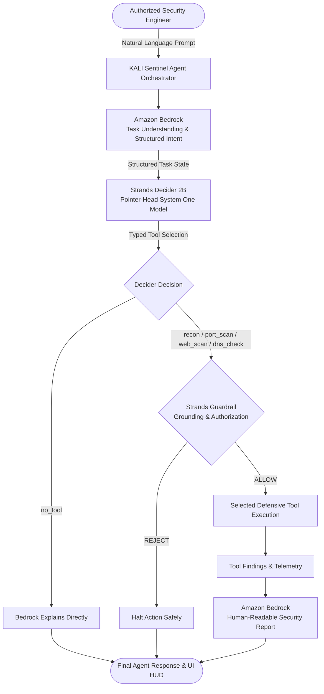

<div align="center">
  <h1>🛡️ KALI Sentinel</h1>
  <p><b>Autonomous Cybersecurity Decision Agent</b></p>
  <p>Built with <b>Amazon Bedrock</b> (Generative Reasoning) and <b>Strands Decider 2B</b> (Typed System One Decisions)</p>
  <p><i>Prepared for the AWS Builder Center "Agent Experience Hackathon: Strands Decider"</i></p>

  <p>
    <a href="https://github.com/tamilarasu006/AWS-KALI-Sentinel"></a>
    
    
    
    
    
  </p>
</div>

---

## 🚀 KALI Sentinel Overview

**KALI Sentinel** transforms generative security workflows by replacing slow, error-prone generative LLM function-calling with **Strands Decider 2B** — a specialized **System One** decision model that evaluates agent state in a single forward pass to make sub-second, calibrated, typed decisions.

### The Problem
Traditional generative agents use large models (14B–70B+ parameters) to read user prompts and generate tool-calling JSON strings token-by-token. In defensive cybersecurity, this introduces:
1. **High Latency (800ms–2500ms):** Delays before a tool is ever invoked.
2. **Hallucination Risk:** Generative models can invent tools, guess parameters, or target unauthorized hosts.
3. **Uncalibrated Output:** Generative models lack mathematically calibrated confidence intervals across valid choices.
4. **Wasted Compute:** Selecting between predefined security tools is a classification and routing problem, not a text generation problem.

### The Solution
KALI Sentinel combines **Amazon Bedrock** and **Strands Decider 2B**:
* **Amazon Bedrock (Generative Reasoning):** Interprets complex user natural language into structured task intent, and later synthesizes professional, human-readable vulnerability reports and defensive remediation advice.
* **Strands Decider 2B (System One Decisions):** Reads the structured state once and evaluates typed questions via a pointer head in **<50ms**, outputting exact option probabilities and calibrated confidence.
* **Dual Decision Boundaries:**
  1. **Tool Selection Pattern:** Answers *"Which security tool should handle this user's authorized security task?"* across `recon`, `port_scan`, `web_scan`, `dns_check`, and `no_tool`.
  2. **Guardrail Pattern:** Answers *"Are the requested tool arguments grounded in the user's stated request and authorized target?"* (`ALLOW` vs `REJECT`), halting unauthorized scans.

---

## 🏛️ Target Architecture



---

## 🎯 Primary Hackathon Decision Pattern: Tool Selection

The primary decision pattern is located in [`decision-patterns/tool-selection/`](decision-patterns/tool-selection/):

* **Typed Question:** `"Which security tool should handle this user's authorized security task?"`
* **Option Set:**
  * `recon`: Passive reconnaissance, OSINT, and footprint discovery.
  * `port_scan`: Network port accessibility, open port detection, and active listening service verification.
  * `web_scan`: Web application security headers (HSTS, CSP, X-Frame-Options) and SSL/TLS posture.
  * `dns_check`: DNS record verification (A, AAAA, MX, TXT), SPF/DKIM/DMARC email compliance.
  * `no_tool`: General conversational inquiry, non-security question, or safety explanation.
* **Output Contract:**
  ```json
  {
    "tool": "port_scan",
    "confidence": 0.9624,
    "probabilities": {
      "recon": 0.0121,
      "port_scan": 0.9624,
      "web_scan": 0.0102,
      "dns_check": 0.0081,
      "no_tool": 0.0072
    },
    "latency_ms": 32.4,
    "model": "StrandsAgents/strands-decider-2B-hobson-v21"
  }
  ```

---

## 🔒 Safety & Authorization Boundaries

KALI Sentinel strictly adheres to defensive cybersecurity principles:
* **Controlled Workflows Only:** Implements passive reconnaissance, non-invasive port checks, HTTP security header auditing, and DNS verification.
* **No Offensive/Destructive Actions:** Malware, credential theft, persistence, exploitation, DDoS, stealth bypass, and scanning of unauthorized third parties are blocked by design.
* **Target Whitelist & Private Scope:** By default, only `localhost`, `127.0.0.1`, RFC 1918 private subnets (`10.0.0.0/8`, `172.16.0.0/12`, `192.168.0.0/16`), or explicitly configured lab targets (`SENTINEL_AUTHORIZED_TARGETS`) are permitted.

---

## 📦 Installation & Setup

KALI Sentinel uses [uv](https://docs.astral.sh/uv/) for high-speed, reproducible Python package management.

### 1. Clone & Environment Setup
```bash
git clone https://github.com/tamilarasu006/AWS-KALI-Sentinel.git
cd AWS-KALI-Sentinel

# Create & sync virtual environment with uv
uv venv
# Windows: .venv\Scripts\activate
# Linux/macOS: source .venv/bin/activate
uv pip install strands-decider boto3 httpx pydantic pytest
```

### 2. Configure AWS & Environment
Copy `.env.example` to `.env`:
```bash
cp .env.example .env
```

Configure your AWS credentials and models (or rely on the standard AWS credential chain `~/.aws/credentials`):
```env
AWS_REGION=us-east-1
BEDROCK_MODEL_ID=anthropic.claude-3-haiku-20240307-v1:0
STRANDS_DECIDER_URL=http://127.0.0.1:8000
STRANDS_DECIDER_MODEL=StrandsAgents/strands-decider-2B-hobson-v21
SENTINEL_SAFE_MODE=true
```

*(Note: KALI Sentinel includes high-fidelity fallback reasoning for CI/CD and offline demonstrations where live AWS credentials or GPU Decider servers are unavailable).*

---

## 🧪 Running the Tests

KALI Sentinel includes 31 unit, integration, and guardrail tests:

```bash
# Run the complete test suite
$env:PYTHONPATH="src"; pytest tests/kali_sentinel/ -v
# Or on Linux/macOS:
PYTHONPATH=src pytest tests/kali_sentinel/ -v
```

Test coverage includes:
* `test_tool_selection.py`: Typed decision validation, confidence boundaries, criteria parsing.
* `test_security_tools.py`: Safe execution of Recon, PortScan, WebScan, and DnsCheck adapters.
* `test_guardrail.py`: Grounding checks, authorized target approval, unauthorized target rejection, and malicious prompt blocking.
* `test_bedrock.py`: Amazon Bedrock intent parsing, report generation, and mocked boto3 Converse API.
* `test_agent.py`: End-to-end agent orchestration, NO_TOOL routing, and execution telemetry.
* `test_routes.py`: FastAPI server routes (`/execute`, `/tools`, `/health`, `/config`).

---

## 🖥️ Running KALI Sentinel Locally

### 1. Start the Backend API Server
```bash
$env:PYTHONPATH="src"; python -m kali_sentinel.server.routes
```
The API server will run on `http://127.0.0.1:8000`.

### 2. (Optional) Run Strands Decider 2B Server
If hosting a live local Decider instance:
```bash
strands-decider serve StrandsAgents/strands-decider-2B-hobson-v21 --port 8000
```

### 3. Start the Frontend UI
```bash
cd frontend
npm install
npm run dev
```
Open `http://localhost:5173/sentinel` in your browser.

---

## 🎬 3-Minute Video Demo Script

Follow this sequence for a compelling video demonstration:

1. **Introduction (0:00 - 0:30):**
   * Introduce **KALI Sentinel** for the AWS Builder Center "Agent Experience Hackathon: Strands Decider".
   * Highlight the architecture: **Amazon Bedrock** for high-level generative reasoning + **Strands Decider 2B** for sub-second System One decision making.
2. **Demo 1: Port Scan Tool Selection (0:30 - 1:15):**
   * Click the **"Port Scan (Lab Server)"** preset: `"Check open ports on my authorized lab server 127.0.0.1"`.
   * Point out the **DECIDER 2B HUD**:
     * Decision: `PORT_SCAN`
     * Confidence: `96.2%`
     * Latency: `~30ms`
   * Point out the **Guardrail**: Verdict `ALLOW` (Target `127.0.0.1` is authorized).
   * Show the tool output: Listening ports 80 and 443 detected.
   * Point out the **Bedrock Security Analysis**: Generates clear, human-readable recommendations.
3. **Demo 2: DNS Security & Web Scan (1:15 - 1:55):**
   * Click **"DNS Audit"** (`test.local`) -> Decider immediately switches to `DNS_CHECK` (94.8% confidence).
   * Click **"Web Security Scan"** -> Decider immediately routes to `WEB_SCAN` (95.4% confidence), evaluating HSTS and CSP headers.
4. **Demo 3: NO_TOOL Routing (1:55 - 2:25):**
   * Click **"Conversational (No Tool)"**: `"What is defense in depth?"`.
   * Show that Decider 2B selects `NO_TOOL` (95%+ confidence).
   * Note how the agent immediately bypasses tool execution, avoiding unnecessary network traffic, while Bedrock directly answers the user's conceptual question.
5. **Demo 4: Safety Guardrail in Action (2:25 - 2:50):**
   * Click **"Unauthorized Target"**: `"Scan open ports on victim-external-target.com"`.
   * Show that although Decider 2B identifies the task semantics as `PORT_SCAN`, the **Guardrail Boundary intercepts and REJECTS** the action because the target is outside authorized lab scope.
   * Execution status displays `BLOCKED`, preventing unauthorized scans.
6. **Conclusion (2:50 - 3:00):**
   * Emphasize the speed, safety, and modularity of the **Strands Decider 2B Tool Selection Pattern**.

---

<div align="center">
  <p><i>KALI Sentinel is built on top of the KALI / OpenDEMON Foundation</i></p>
</div>

---

## KALI AI Foundation Background


Personal AI agents are exploding in popularity, but nearly all of them still route intelligence through cloud APIs. Your "personal" AI continues to depend on someone else's server. At the same time, our [Intelligence Per Watt](https://www.intelligence-per-watt.ai/) research showed that local language models already handle 88.7% of single-turn chat and reasoning queries, with intelligence efficiency improving 5.3× from 2023 to 2025. The models and hardware are increasingly ready. What has been missing is the software stack to make local-first personal AI practical.

KALI AI (formerly OpenDEMON) is that stack. It is a framework for local-first personal AI, built around three core ideas: shared primitives for building on-device agents; evaluations that treat energy, FLOPs, latency, and dollar cost as first-class constraints alongside accuracy; and a learning loop that improves models using local trace data. The goal is simple: make it possible to build personal AI agents that run locally by default, calling the cloud only when truly necessary. KALI AI aims to be both a research platform and a production foundation for local AI, in the spirit of PyTorch.

## Installation

Pick your platform and run one command. Each installer handles [uv](https://docs.astral.sh/uv/), the Python venv, Ollama, and a starter model — about 3 minutes on broadband.

| Platform | One-liner |
|---|---|
| **macOS · Linux · WSL2** | `curl -fsSL https://DEMON.github.io/DEMON/install.sh \| bash` |
| **Native Windows** | `irm https://DEMON.github.io/DEMON/install.ps1 \| iex` |
| **Desktop GUI** | Download `.exe` / `.dmg` / `.deb` / `.rpm` / `.AppImage` from the [latest release](https://github.com/DEMON/DEMON/releases) |

Then `DEMON` to start. The Rust extension and larger models continue downloading in the background; `DEMON doctor` shows status.

Platform-specific notes (WSL2 setup, native-Windows scheduled-task service, desktop prerequisites, manual / contributor install): see the [installation docs](https://DEMON.github.io/DEMON/getting-started/install/).

## Quick Start

```bash
DEMON                          # start chatting (default: chat-simple)
DEMON init --preset <name>     # switch to a starter config
```

> Prefix `DEMON ...` with `uv run`, or `source .venv/bin/activate` first.

| Preset | What it does |
|---|---|
| `morning-digest-mac` / `morning-digest-linux` / `morning-digest-minimal` | Spoken daily briefing from email, calendar, health, news |
| `deep-research` | Multi-hop research across indexed docs with citations |
| `code-assistant` | Agent with code execution, file I/O, and shell access |
| `scheduled-monitor` | Stateful agent on a schedule with memory |
| `chat-simple` | Lightweight conversation, no tools |

Example:

```bash
DEMON init --preset morning-digest-mac
DEMON connect gdrive          # one OAuth covers Gmail / Calendar / Tasks
DEMON digest --fresh          # generate and play your first briefing
```

Per-preset deep dives: [morning digest](https://DEMON.github.io/DEMON/user-guide/morning-digest/) · [deep research](https://DEMON.github.io/DEMON/user-guide/deep-research/) · [code assistant](https://DEMON.github.io/DEMON/user-guide/code-assistant/) · [scheduled monitor](https://DEMON.github.io/DEMON/user-guide/scheduled-monitor/) · [chat simple](https://DEMON.github.io/DEMON/user-guide/chat-simple/) · or the full [quickstart guide](https://DEMON.github.io/DEMON/getting-started/quickstart/).

### Skills

Skills teach agents how to better use tools and improve their reasoning. Every skill is a tool — agents discover them from a catalog and invoke them on demand.

```bash
# Install skills from public sources
DEMON skill install hermes:arxiv
DEMON skill sync hermes --category research

# Use skills with any agent
DEMON ask "Use the code-explainer skill to explain this Python code: for i in range(5): print(i*2)"

# Optimize skills from your trace history
DEMON optimize skills --policy dspy

# Benchmark the impact
DEMON bench skills --max-samples 5 --seeds 42
```

Import from [Hermes Agent](https://github.com/NousResearch/hermes-agent) (~150 skills), [OpenClaw](https://github.com/openclaw/skills) (~13,700 community skills), or any GitHub repo. Skills follow the [agentskills.io](https://agentskills.io/specification) open standard.

See the [Skills User Guide](https://DEMON.github.io/DEMON/user-guide/skills/) and [Skills Tutorial](https://DEMON.github.io/DEMON/tutorials/skills-workflow/) for details.

### Built-in Agents

DEMON ships with eight built-in agents across three execution modes (on-demand, scheduled, continuous):

| Agent | Type | What it does |
|-------|------|-------------|
| `morning_digest` | Scheduled | Daily briefing from email, calendar, health, news — with TTS audio |
| `deep_research` | On-demand | Multi-hop research with citations across web and local docs |
| `monitor_operative` | Continuous | Long-horizon monitoring with memory, compression, and retrieval |
| `orchestrator` | On-demand | Multi-turn reasoning with automatic tool selection |
| `native_react` | On-demand | ReAct (Thought-Action-Observation) loop agent |
| `operative` | Continuous | Persistent autonomous agent with state management |
| `native_openhands` | On-demand | CodeAct — generates and executes Python code |
| `simple` | On-demand | Single-turn chat, no tools |

See the [User Guide](https://DEMON.github.io/DEMON/user-guide/morning-digest/) and [Tutorials](https://DEMON.github.io/DEMON/tutorials/) for detailed setup instructions.

Full documentation — including Docker deployment, cloud engines, development setup, and tutorials — at **[DEMON.github.io/DEMON](https://DEMON.github.io/DEMON/)**.

## Community

- **GitHub:** [github.com/DEMON/DEMON](https://github.com/DEMON/DEMON)
- **Discord:** [discord.gg/CMVBmDQ5Fj](https://discord.gg/CMVBmDQ5Fj)
- **X / Twitter:** [@DEMONAI](https://x.com/DEMONAI)
- **Docs:** [DEMON.github.io/DEMON](https://DEMON.github.io/DEMON/)

## Contributing

We welcome contributions! See the [Contributing Guide](CONTRIBUTING.md) for incentives, contribution types, and the PR process.

Quick start for contributors:

```bash
git clone https://github.com/DEMON/DEMON.git
cd DEMON
uv sync --extra dev
uv run pre-commit install
uv run pytest tests/ -v
```

Browse the [Roadmap](https://DEMON.github.io/DEMON/development/roadmap/) for areas where help is needed. Comment **"take"** on any issue to get auto-assigned.

## About

DEMON is part of [Intelligence Per Watt](https://www.intelligence-per-watt.ai/), a research initiative studying the intelligence efficiency of AI systems. The project is developed at [Hazy Research](https://hazyresearch.stanford.edu/) and the [Scaling Intelligence Lab](https://scalingintelligence.stanford.edu/) at [Stanford SAIL](https://ai.stanford.edu/).

## Sponsors

<p>
  <a href="https://www.laude.org/">Laude Institute</a> &bull;
  <a href="https://datascience.stanford.edu/marlowe">Stanford Marlowe</a> &bull;
  <a href="https://cloud.google.com/">Google Cloud Platform</a> &bull;
  <a href="https://lambda.ai/">Lambda Labs</a> &bull;
  <a href="https://ollama.com/">Ollama</a> &bull;
  <a href="https://research.ibm.com/">IBM Research</a> &bull;
  <a href="https://hai.stanford.edu/">Stanford HAI</a>
</p>

## Citation
```bibtex
@misc{saadfalcon2026DEMONpersonalaipersonal,
      title={DEMON: Personal AI, On Personal Devices}, 
      author={Jon Saad-Falcon and Avanika Narayan and Robby Manihani and Tanvir Bhathal and Herumb Shandilya and Hakki Orhun Akengin and Gabriel Bo and Andrew Park and Matthew Hart and Caia Costello and Chuan Li and Christopher Ré and Azalia Mirhoseini},
      year={2026},
      eprint={2605.17172},
      archivePrefix={arXiv},
      primaryClass={cs.LG},
      url={https://arxiv.org/abs/2605.17172}, 
}
```

## License

[Apache 2.0](LICENSE)
