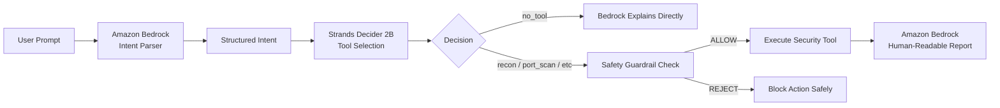

# Strands Decider 2B Pattern: Defensive Tool Selection

A reusable **System One** decision pattern built for the **AWS Builder Center "Agent Experience Hackathon: Strands Decider"**.

This pattern replaces expensive, probabilistic generative LLM tool-calling loops with a calibrated, sub-second decision model (**Strands Decider 2B**) to select which security tool should handle an authorized security task.

---

## 1. What Problem This Pattern Solves

Traditional generative agents rely on large language models (14B–70B+ parameters) to read user prompts, reason, and emit function-call JSON. This approach has critical drawbacks in cybersecurity agents:

1. **High Latency:** Generative decoding adds 800ms–2500ms before a tool is ever invoked.
2. **Hallucination Risk:** Generative models can invent tools, guess non-existent parameters, or hallucinate targets.
3. **Uncalibrated Output:** Generative models do not output mathematically calibrated confidence intervals across valid choices.
4. **Wasted Compute:** Choosing between 5 predefined tools is a classification and routing problem, not a text generation problem.

**Strands Decider 2B** solves this by evaluating the input state in a single forward pass through a pointer head. It computes exact probabilities and calibrated confidence across the option set in **under 50ms**, ensuring instantaneous, deterministic tool routing.

---

## 2. The Typed Decision Contract

### Typed Question
```text
Which security tool should handle this user's authorized security task?
```

### Option Set & Criteria
| Tool Option | Description & Criteria |
| :--- | :--- |
| **`recon`** | Passive reconnaissance, OSINT, domain footprinting, and asset discovery. |
| **`port_scan`** | Network port accessibility, open port detection, and active listening service verification. |
| **`web_scan`** | Web application security headers (HSTS, CSP, X-Frame-Options), SSL/TLS posture, and HTTP audit. |
| **`dns_check`** | DNS record verification (A, AAAA, MX, TXT), SPF/DKIM/DMARC email compliance, and nameservers. |
| **`no_tool`** | General informational inquiry, conversational greeting, safety explanation, or out-of-scope task. |

---

## 3. Expected Input State

The Decider reads a structured text representation of the current agent state:

```text
User Task: Check open ports on my authorized lab server 127.0.0.1
Interpreted Action: port_discovery
Target: 127.0.0.1
Authorization Status: Confirmed
Parameters: {'ports': [80, 443, 8080]}
```

---

## 4. Expected Output Contract

The pattern returns a strongly-typed `ToolDecision`:

```json
{
  "tool": "port_scan",
  "confidence": 0.9624,
  "probabilities": {
    "recon": 0.0121,
    "port_scan": 0.9624,
    "web_scan": 0.0102,
    "dns_check": 0.0081,
    "no_tool": 0.0072
  },
  "latency_ms": 32.4,
  "model": "StrandsAgents/strands-decider-2B-hobson-v21"
}
```

---

## 5. Wiring Strands Decider 2B into an Agent

In an agentic loop:



1. **Amazon Bedrock** parses unstructured user language into structured task intent.
2. **Strands Decider 2B** makes the typed tool choice in a single forward pass.
3. If `tool == "no_tool"`, tool execution is bypassed immediately.
4. Otherwise, the agent executes the chosen defensive security adapter.
5. **Amazon Bedrock** generates the final contextual analysis for the user.

---

## 6. How Another Developer Can Reuse This Pattern

You can run this pattern independently from KALI Sentinel using standard libraries.

### Step 1: Install `strands-decider` and `httpx`
```bash
pip install strands-decider httpx pydantic
```

### Step 2: Start the Strands Decider Server
```bash
strands-decider serve StrandsAgents/strands-decider-2B-hobson-v21 --port 8000
```

### Step 3: Run the example script
```bash
python decision-patterns/tool-selection/example.py
```

---

## 7. Safety Considerations

1. **Defensive Only:** This decision pattern must only route to controlled, non-destructive tools (read-only audits, local lab ports, DNS records).
2. **Authorized Scope:** Pair this pattern with an authorization guardrail (`StrandsGuardrailDecider` or RFC 1918 private subnet checks) before firing network sockets.
3. **Calibrated Confidence Thresholding:** If `decision.confidence < 0.60`, agents should prompt the user for clarification rather than executing an ambiguous tool action.
