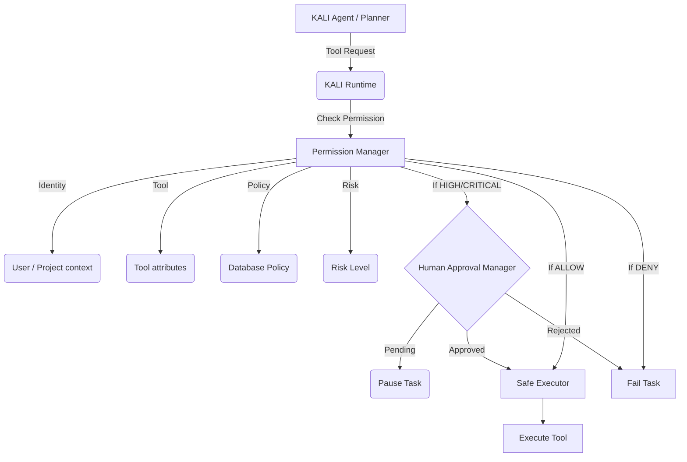

# KALI Permission, Authorization & Human Approval System

## Overview

The KALI Permission System acts as a strict gateway between KALI reasoning/planning and the actual execution of tools. It enforces a "Default Deny" policy, ensures multi-tenant isolation, respects explicit policies, and mandates human approval for high-risk operations. 

It guarantees that the agent cannot execute any tools unilaterally if they pose significant risks.

## Architecture

The permission system integrates at the **KALI Runtime** layer, intercepting tool execution requests before they reach the `SafeExecutor`.

## Evaluation Flow

Permissions are evaluated deterministically in the following order:

1. **Tool State Validation:** 
   - Is the tool enabled? (Disabled tools are denied immediately).
   
2. **Context Validation:**
   - Are `user_id`, `project_id`, and `task_id` present? Isolation requires complete context.
   
3. **Cybersecurity Scope Validation:**
   - If the tool category is `cybersecurity`, an explicit `AuthorizationScope` object is required.
   - The tool's `target` must fall within the `allowed_targets` (e.g., specific domains, CIDRs).

4. **Project Policy Evaluation:**
   - Project-specific explicit `denied_permissions` or `denied_tools` immediately reject the execution.
   - If a tool or its required permissions are listed in `allowed_tools` or `allowed_permissions`, it passes the policy check.

5. **Risk-Level Evaluation:**
   - **LOW Risk:** Auto-approved if not blocked by policy.
   - **MEDIUM Risk:** Requires an explicit policy allow (e.g., project owner allowed specific medium risk actions).
   - **HIGH / CRITICAL Risk:** Always requires explicit human approval.

## Human Approval Lifecycle

When a High/Critical risk tool is invoked:

1. The `KALIPermissionManager` returns a `REQUIRE_APPROVAL` decision.
2. The `KALIRuntime` intercepts this and pauses the current task.
3. The `KALIApprovalManager` creates a `KaliApprovalRequest` in the database with a 24-hour expiration.
4. (Optional UI/Notification system alerts the user).
5. The user reviews the request and either Approves, Rejects, or Cancels it via the API (`/api/v1/kali/approvals`).
   - If Approved: The orchestrator resumes the task, and on retry, the Permission Manager sees the approved request and allows execution.
   - If Rejected: The task fails immediately.

## Data Models

* **KaliPermissionDecision (Audit Log):** Immutable record of every tool permission check, detailing the outcome (ALLOW/DENY/REQUIRE_APPROVAL) and the rationale. Sensitive inputs are not stored in this record.
* **KaliPermissionPolicy:** Defines allowed/denied tools and permissions at a user or project level.
* **KaliApprovalRequest:** Tracks pending, approved, rejected, or expired human approvals.
* **AuthorizationScope:** Strictly scopes targets (IPs, subnets, domains) for cybersecurity and destructive tools.

## API Routes

The approval system provides secure REST endpoints under `/api/v1/kali/approvals/`:
- `GET /` : List pending approvals for the current user.
- `GET /{id}` : View a specific approval request.
- `POST /{id}/approve` : Approve the request.
- `POST /{id}/reject` : Reject the request.
- `POST /{id}/cancel` : Cancel the request.

All routes enforce strict multi-tenant isolation, ensuring a user can only access and approve their own requests.
