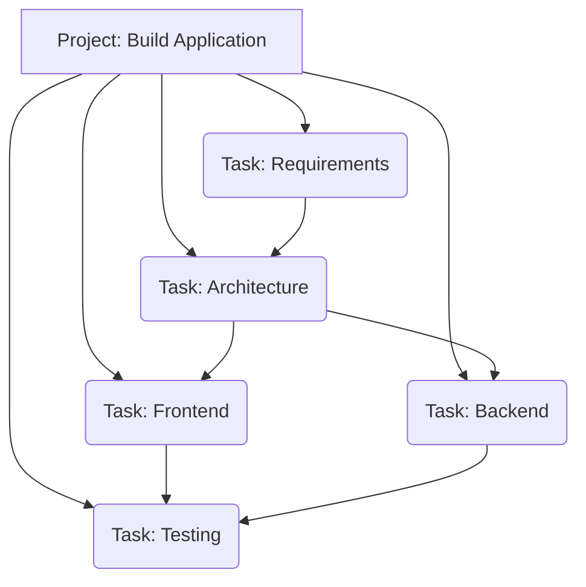

# KALI Project Management System

The KALI Project System provides an organizational layer on top of the KALI Core Runtime (introduced in Phase 19). It translates high-level user requests (e.g., "Build a full-stack application") into manageable, hierarchical task trees rooted in a persistent Project entity.

## The `KaliProject` Entity

A `KaliProject` serves as the highest-level scope for a multi-step orchestration process. It guarantees strict user isolation, context boundaries, and shared metadata handling.

### Key Fields:
- `user_id`: Enforces strict tenant isolation.
- `objective`: The original high-level goal provided by the user.
- `workspace`: A dynamic JSON block containing environment metadata (e.g., git branch, directory paths, dependency graphs) shared across all child tasks.
- `status`: Current status of the project lifecycle.

## Multi-Step Task Management

Tasks (`KaliTask`) map directly to a parent project and form a Directed Acyclic Graph (DAG) using `parent_task_id` and `dependencies`.

### Example Hierarchy

### Advanced Task Features

1. **History & Events:** Every state transition (creation, start, completion, failure, retry) dispatches an event via the `EventManager` to the `kali_runtime_events` table. `runtime.events.get_events(task_id)` aggregates these for timeline views.
2. **Retry Mechanism:** `runtime.retry_task(task_id)` allows gracefully recovering failed nodes in the DAG. It resets the state to `PENDING` and increments a retry counter up to `max_retries`.
3. **Cancellation:** `runtime.cancel_task(task_id)` recursively cascades down the tree, halting all child nodes synchronously.
4. **Task Updates:** `runtime.update_task` allows dynamic adjustment of priorities and assigned agents mid-flight.

## REST API Integration

The project layer exposes the following routes for external orchestration:
- `POST /v1/projects` (Initialize context and workspace)
- `GET /v1/projects/{id}` (Read project status and workspace context)
- `POST /v1/projects/{id}/tasks` (Append a root task to the project tree)
- `GET /v1/projects/{id}/tasks` (Retrieve the full tree)
